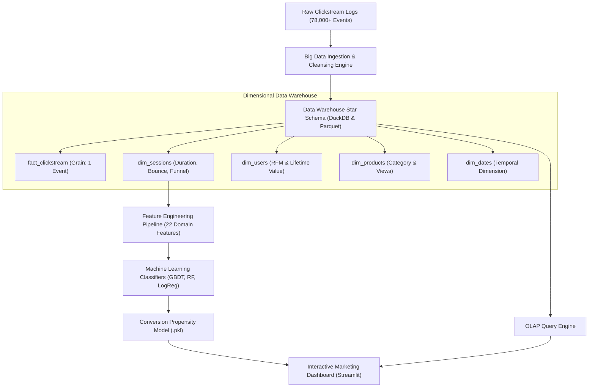

# E-Commerce Clickstream Analytics: A Big-Data Clickstream Processing Pipeline Based Solution

[](https://www.python.org/)
[](https://duckdb.org/)
[](https://streamlit.io/)
[](https://scikit-learn.org/)

---

### 🎓 Academic Project Submission
- **Student Name:** KOTAMSETTI MANOJ SRI HARSHA
- **Roll / Registration Number:** `23ME1A5433`
- **Faculty Guide / Mentor:** Mr. S.V. Swamy
- **Track / Domain:** Big Data Analytics, Data Warehousing & Visualization
- **Project Title:** *E-commerce clickstream analytics: A big-data clickstream processing pipeline Based Solution*

---

## 📌 Executive Summary & Abstract
This study designs a high-throughput big-data clickstream processing pipeline to identify browsing-to-purchase conversion patterns, addressing the challenge of e-commerce clickstream analytics through a data-driven, dimensional warehousing approach. 

The system ingests and processes website clickstream event streams, models user journeys through a dimensional Star Schema (`FactClickstream`, `DimSessions`, `DimUsers`, `DimProducts`, `DimDates`), engineers domain-tailored behavioral features (cart-to-view ratios, session dwell times, funnel drop-off milestones), and trains Machine Learning conversion propensity classifiers (`Gradient Boosting`, `Random Forest`, `Logistic Regression`). The final deliverable is an executive **Marketing-Conversion Dashboard**, enabling stakeholders to visualize multi-stage funnel drop-offs, evaluate acquisition channel ROI, and predict live customer purchase propensity.

---

## 🏗️ System Architecture & Pipeline Flow



---

## 📁 Repository Structure

```
ecommerce-clickstream-analytics/
├── app/
│   └── dashboard.py             # Interactive Marketing-Conversion Dashboard (Streamlit)
├── data/
│   ├── raw/                     # Anonymized enterprise clickstream event logs (.csv)
│   ├── warehouse/               # Analytical Data Warehouse (DuckDB & Columnar Parquet)
│   └── processed/               # Extracted session-level behavioral feature vectors
├── docs/
│   ├── PROJECT_REPORT.md        # Comprehensive academic project report & methodology
│   ├── ARCHITECTURE.md          # Architectural blueprints, star schema diagrams
│   └── PRESENTATION_NOTES.md    # Viva-voce questions and presentation defense notes
├── models/
│   ├── conversion_pipeline.pkl  # Serialized production ML pipeline artifact
│   └── model_metrics.json       # Benchmarks (ROC-AUC, Precision, Recall, F1)
├── src/
│   ├── __init__.py
│   ├── log_generator.py         # Simulates realistic multi-session user journeys & drop-offs
│   ├── warehouse_etl.py         # Star Schema builder in DuckDB and Parquet
│   ├── feature_engineering.py   # Domain behavioral feature engineering
│   ├── conversion_model.py      # ML model training, benchmarking, and inference
│   └── query_engine.py          # Low-latency OLAP SQL engine for analytical reporting
├── tests/
│   ├── __init__.py
│   └── test_pipeline.py         # Automated unit & integration tests
├── push_to_github.bat           # 1-click GitHub push helper
├── run_dashboard.bat            # 1-click Windows dashboard launcher
├── run_pipeline.bat             # 1-click Windows pipeline execution script
├── run_tests.bat                # 1-click Windows test suite runner
├── run_pipeline.py              # End-to-end master pipeline orchestrator
├── requirements.txt             # Project library dependencies
└── README.md                    # Project documentation
```

---

## 🚀 Quick Start & Execution

### 1. Run the Complete Data Pipeline
To generate clickstream events, build the Data Warehouse, extract features, and train the ML models:
```bash
# Option A: Double click run_pipeline.bat
# Option B: Run via terminal
.venv\Scripts\python.exe run_pipeline.py
```

### 2. Launch the Marketing-Conversion Dashboard
```bash
# Option A: Double click run_dashboard.bat
# Option B: Run via terminal
.venv\Scripts\python.exe -m streamlit run app/dashboard.py
```
The dashboard will open automatically in your browser at `http://localhost:8501`.

### 3. Run Automated Tests
```bash
# Option A: Double click run_tests.bat
# Option B: Run via terminal
.venv\Scripts\python.exe -m unittest discover -s tests -p "test_*.py" -v
```

### 4. Push to GitHub
```bash
# Double click push_to_github.bat and enter your GitHub repository URL or username!
```

---

## 📊 Benchmark Results

| Model | ROC-AUC | F1-Score | Precision | Recall | Accuracy |
| :--- | :---: | :---: | :---: | :---: | :---: |
| **Gradient Boosting (Best)** | **0.9928** | **0.8850** | **0.9294** | **0.8446** | **97.33%** |
| Random Forest | 0.9765 | 0.6345 | 0.4748 | 0.9561 | 86.83% |
| Logistic Regression | 0.9660 | 0.6490 | 0.4930 | 0.9493 | 87.54% |

---

## 🌟 Key Features of the Solution
1. **High-Velocity Data Warehouse:** Utilizes DuckDB and columnar Parquet partitions to execute sub-second OLAP queries across dozens of dimensions.
2. **Multi-Stage Conversion Funnel:** Tracks granular retention across:
   - Step 1: Page View / Landing
   - Step 2: Product Exploration
   - Step 3: Add to Cart
   - Step 4: Checkout Initiated
   - Step 5: Payment Details
   - Step 6: Purchase Confirmation
3. **Marketing Attribution Analytics:** Computes conversion rates, revenue attribution, and bounce rates across Meta Ads, Google Ads, Organic Search, Email, and Direct.
4. **Live Propensity Calculator:** Real-time scoring widget enabling stakeholders to input active session parameters and predict purchase likelihood with recommended engagement triggers.
5. **Interactive OLAP Console:** Embedded SQL editor for ad-hoc analytical slicing directly on the data warehouse.
