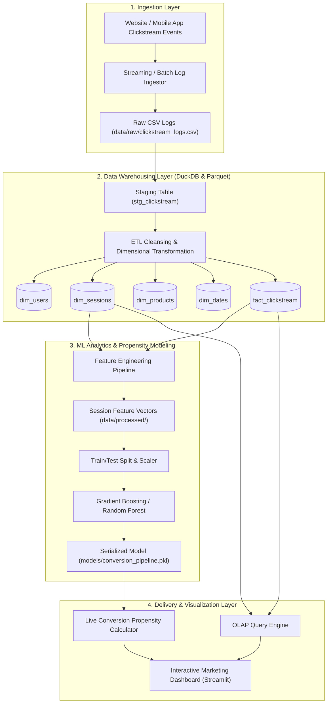
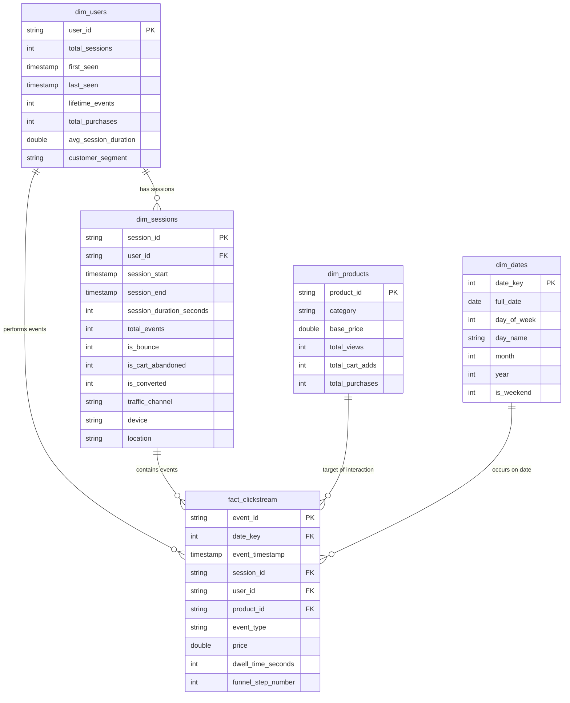
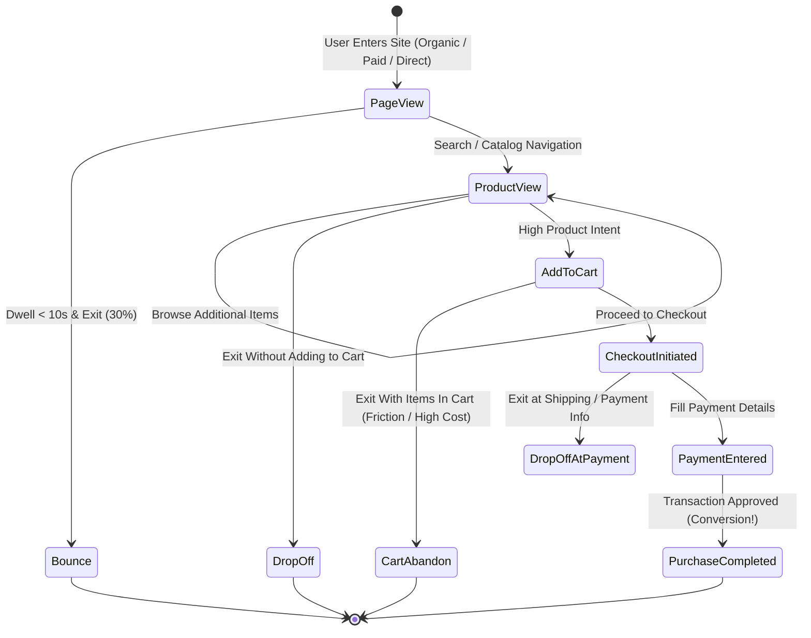

# ARCHITECTURE BLUEPRINT & DATA WAREHOUSE SCHEMA

## Project: E-Commerce Clickstream Analytics Pipeline
- **Student:** KOTAMSETTI MANOJ SRI HARSHA (23ME1A5433)
- **Guide:** Mr. S.V. Swamy
- **Track:** Big Data Analytics, Data Warehousing & Visualization

---

## 1. End-to-End Data Pipeline Architecture

---

## 2. Dimensional Star Schema (Entity-Relationship Diagram)

---

## 3. Browsing-to-Purchase Funnel State Transitions

